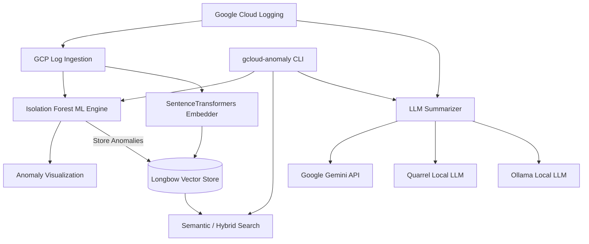

# System Architecture

`gcloud-logs-anomaly-detection` provides end-to-end log anomaly detection, semantic search, and LLM-driven summarization for Google Cloud Logging.

## Core Subsystems

### 1. Machine Learning Engine

- **Model**: Scikit-Learn `IsolationForest` (unsupervised outlier detection).
- **Features Extracted**: Normalized timestamp, mapped integer severity (DEBUG=1 to CRITICAL=5), and message length.
- **Output**: Anomaly flags (`1` normal, `-1` anomaly) and scatter visual artifacts.

### 2. High-Performance Vector Storage (Longbow)

- **Vector Database**: Longbow gRPC service (`port 3000` data, `port 3001` metadata).
- **Embeddings**: `SentenceTransformer` with default `all-MiniLM-L6-v2` generating 384-dimensional dense vectors.
- **Search Capabilities**:
  - `dense`: Pure vector cosine similarity
  - `sparse`: BM25 keyword matching
  - `filtered`: Metadata predicate evaluation
  - `hybrid`: Reciprocal Rank Fusion (RRF) combining dense and sparse
  - `temporal`: Time-window scoped queries
  - `by-id`: Direct vector lookup
  - `turboquant`: High-compression vector indexing
- **Resilience Features**:
  - **Circuit Breaker**: Prevents cascade failures with automatic backoff and half-open probes.
  - **Watermark Tracking**: Ensures idempotent incremental log ingestion.
  - **Search Caching**: LRU/TTL caching for frequent semantic queries.
  - **Async Batching**: Thread-pooled concurrent embedding and ingestion.

### 3. LLM Inference Layer

Provides multi-backend log synthesis:

- **Google Gemini**: Via `langchain-google-genai` and ADC.
- **Longbow-Quarrel**: High-performance local GGUF model runner with an OpenAI-compatible API (`http://localhost:8080/v1`).
- **Ollama**: Local lightweight model runner (`smollm2:135m`).

### 4. DevSecOps & Containerization

- **Multi-Stage Dockerfile**: Pinned Python 3.14-slim builder with strict cache controls and stripped runtime image.
- **Least Privilege**: Runs exclusively as non-privileged `appuser` (UID 1000).
- **Healthchecks**: Real-time import and service validation probes.
- **Docker Compose**: Standardized multi-container orchestration for local development and production.
